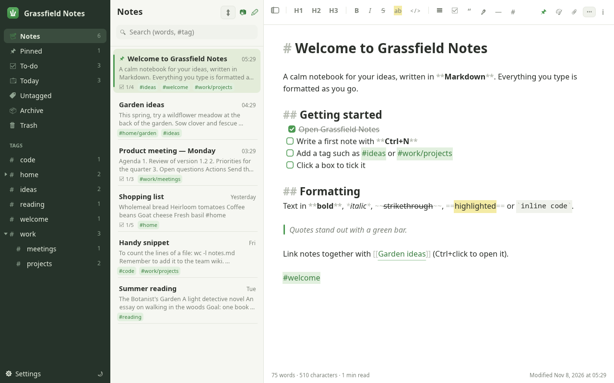
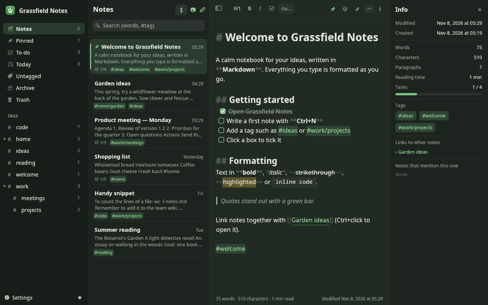
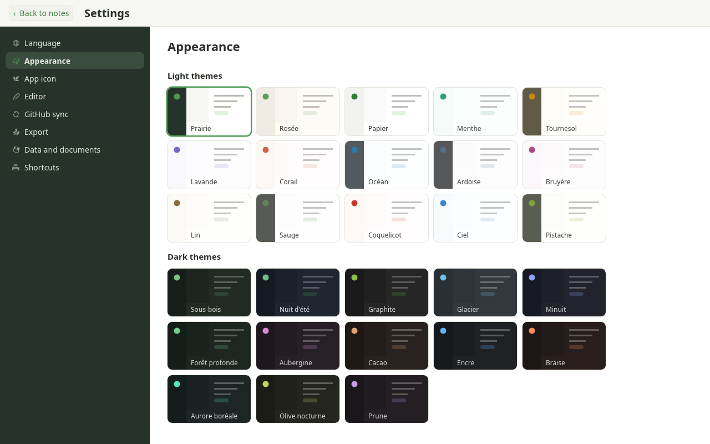
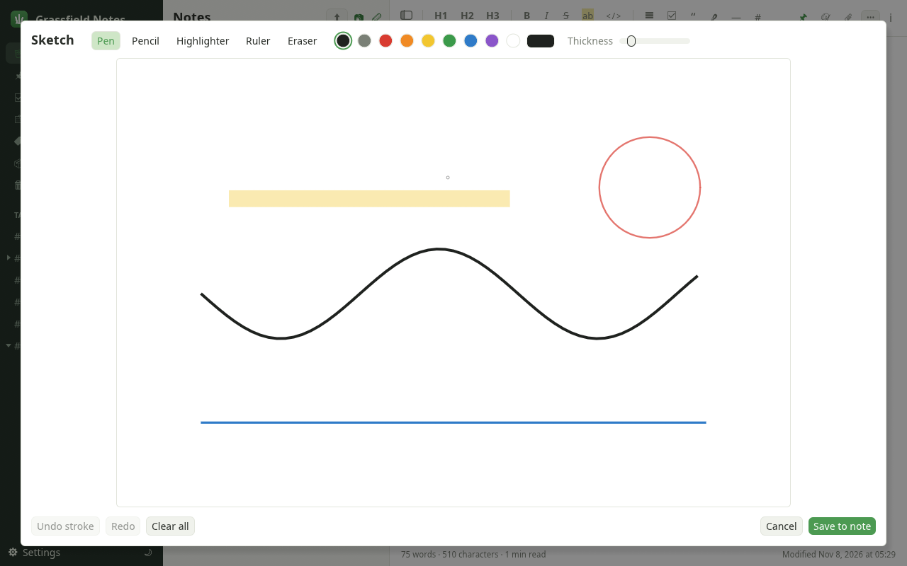
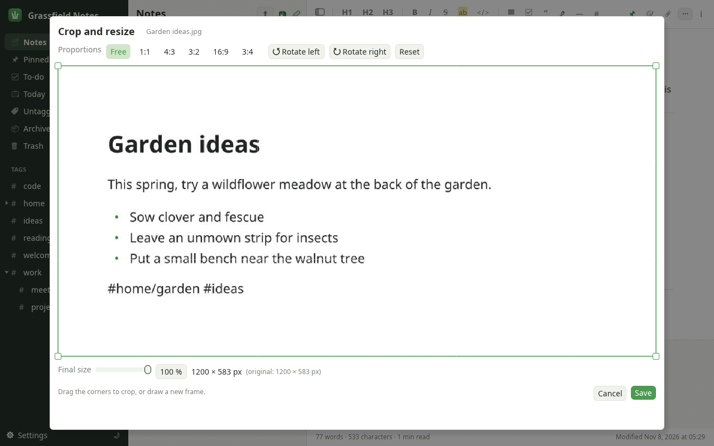
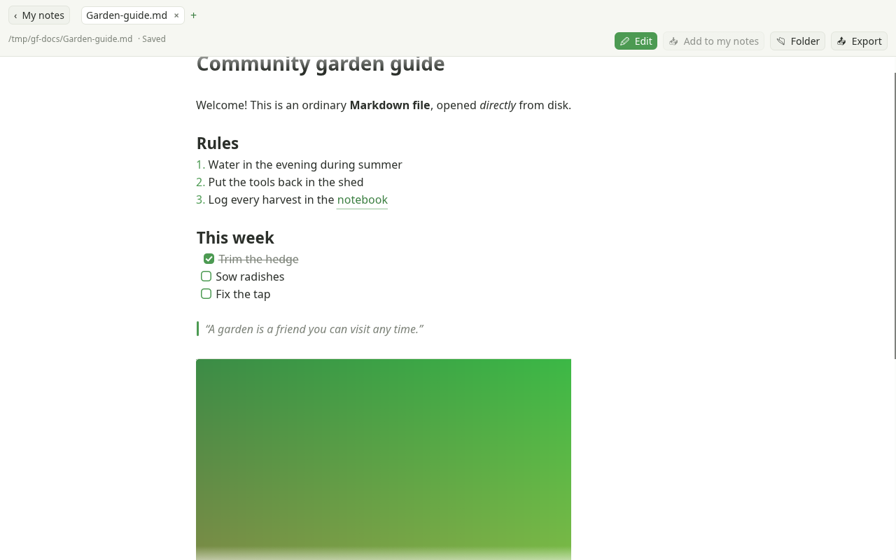
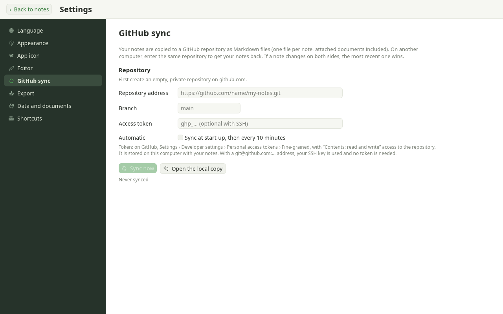

# Grassfield Notes

[](https://github.com/grassfieldhq/grassfield-notes/actions/workflows/ci.yml)
[](https://github.com/grassfieldhq/grassfield-notes/releases)
[](LICENSE)

**A calm, private Markdown notebook for your desktop.**
Write in Markdown and see it styled as you type, organise notes with `#tags`, draw sketches, scan documents and search inside them, sync through your own GitHub repository, and open any `.md` file on your computer. Everything stays on your machine unless you choose to sync it.



> Grassfield Notes is written in Rust with [egui](https://github.com/emilk/egui). It runs offline, has no account, no telemetry and no ads.

---

## Features

### Writing
- **Live Markdown**: headings, **bold**, *italic*, ~~strikethrough~~, ==highlight==, `inline code`, code blocks, quotes, bulleted and numbered lists, dividers and links, all styled as you type. The Markdown symbols fade into the background, so the text stays readable.
- **To-do lists**: `- [ ]` items become real checkboxes you can click (or toggle with `Ctrl+Enter`).
- **Note links**: `[[Another note]]` links notes together. `Ctrl+click` opens the note, or creates it if it doesn't exist. The info panel lists backlinks.
- **Formatting toolbar** and keyboard shortcuts for everything. On narrow windows the toolbar shrinks to fit.
- **Focus mode** hides the side columns.

### Organising
- **Tags** anywhere in the text (`#ideas`, nested `#work/projects`), shown as a tree in the sidebar. Tags can be renamed or removed across all notes in one go.
- Smart sections: **Pinned**, **To-do** (notes with open tasks), **Today**, **Untagged**, **Archive** and **Trash**.
- **Search** by words or `#tag`, including the text found inside scanned images and PDFs.
- Sort by date modified, date created or title.

### Pictures, sketches and documents
- **Sketches**: draw with a pen, pencil, highlighter, ruler or eraser, in any colour and thickness, with undo/redo. Sketches sit inline in the note and stay editable.
- **Images inline**: dropped or attached images appear inside the text. Double-click one to **crop, rotate or resize** it.
- **Document scanning**: add photos, scans or PDFs to a note. Their text is read in the background (OCR with [Tesseract](https://github.com/tesseract-ocr/tesseract), PDFs with `pdftotext`), so search finds them.

### Standalone Markdown files
- Open **any `.md` file** on your computer without importing it: drag it onto the window, press `Ctrl+O`, pass it on the command line (`grassfield-notes README.md`), or make Grassfield Notes your default app for `.md` files (Linux: *Settings → Data and documents*).
- **Reading mode** hides the Markdown symbols. Links to other `.md` files open in new tabs, and pictures next to the file are shown.
- **Editing mode** saves back to the same file automatically. If another program changes the file, it reloads, or tells you when there is a conflict.
- *Add to my notes* copies the file, and its pictures, into your notebook.

### Export
Export one note, a list or everything to **TXT, Markdown, TextBundle, RTF, PDF, JPG, HTML, DOCX and ePub**. PDF, JPG, HTML, ePub and TextBundle include your pictures. PDF output embeds fonts, so accents and symbols print correctly.

### Sync with GitHub
Keep your notes in **your own private GitHub repository** (or any git remote). Each note is a plain Markdown file, so your notebook stays readable and portable. When a note changes on two computers, the newest edit wins. Sync runs in the background, on demand or automatically every 10 minutes.

### Make it yours
- **28 themes** (light and dark) and **15 app icons**.
- Editor font (sans, serif or mono), size, line spacing and line width.
- **6 languages**: English, Français, Español, Deutsch, Italiano and Português. The app follows your computer's language, or you can choose one.

---

## Screenshots

| Dark theme with the info panel | 28 themes |
|---|---|
|  |  |
| **Sketches** | **Crop and resize** |
|  |  |
| **Standalone Markdown file (reading mode)** | **GitHub sync settings** |
|  |  |

---

## Installation

### Pre-built binaries
Grassfield Notes runs on **Linux, Windows and macOS** from the same code. Download your system's build from the [**Releases** page](https://github.com/grassfieldhq/grassfield-notes/releases); CI produces them for each tagged version.

| System | Download | First launch |
|---|---|---|
| **Linux** (x86_64, Wayland or X11) | `…-linux-x86_64.tar.gz` (program, icon, `.desktop` file) | Extract it and run `grassfield-notes`. To add it to your app menu, copy the `.desktop` file to `~/.local/share/applications/` and adjust its `Exec=` path. |
| **Windows** 10/11 (x86_64) | `…-windows-x86_64.zip` | Extract it and run `grassfield-notes.exe`. The build isn't signed yet, so if SmartScreen warns you, choose *More info → Run anyway*. |
| **macOS** 11+ (Apple Silicon and Intel) | `…-macos-universal.zip` (`Grassfield Notes.app`) | Move the app to *Applications*. It isn't notarised yet, so the first time, right-click it and choose *Open*. |

### Build from source
You need a recent stable [Rust toolchain](https://rustup.rs).

```sh
git clone https://github.com/grassfieldhq/grassfield-notes.git
cd grassfield-notes
cargo build --release
./target/release/grassfield-notes
```

On **Linux** you also need the usual windowing and OpenGL development packages. On Debian/Ubuntu, for example:

```sh
sudo apt install libxkbcommon-dev libgl1-mesa-dev libwayland-dev libx11-dev
```

### Optional tools
These are only needed for some features. The app tells you in *Settings → Data and documents* whether it found them.

| Feature | Tool | Debian/Ubuntu | Arch | macOS (Homebrew) |
|---|---|---|---|---|
| GitHub sync | `git` | `git` | `git` | `git` |
| Text inside images | `tesseract` + language data | `tesseract-ocr tesseract-ocr-eng` (`-fra`, `-deu`, …) | `tesseract tesseract-data-eng` | `tesseract tesseract-lang` |
| Text inside PDFs | `pdftotext` | `poppler-utils` | `poppler` | `poppler` |

On **Windows**, install [Git for Windows](https://git-scm.com/download/win), Tesseract (for example from the [UB Mannheim builds](https://github.com/UB-Mannheim/tesseract/wiki)) and Poppler (`winget install oschwartz10612.Poppler`, or Scoop/Chocolatey), and make sure they are on your `PATH`.

---

## Using Grassfield Notes

### Keyboard shortcuts
| Shortcut | Action |
|---|---|
| `Ctrl+N` | New note |
| `Ctrl+F` | Search |
| `Ctrl+O` | Open a Markdown file |
| `Ctrl+S` / `Ctrl+W` | Save / close the open Markdown file |
| `Ctrl+B` / `Ctrl+I` | Bold / italic |
| `Ctrl+Shift+X` / `Ctrl+Shift+H` | Strikethrough / highlight |
| `Ctrl+K` | Link to a note `[[…]]` |
| `Ctrl+Enter` | Tick / untick the task on the current line |
| `Ctrl+click` | Open a link, note link or tag |
| `Ctrl+Shift+F` (or `F11`) | Focus mode |
| `Ctrl+Shift+I` | Note info |
| `Ctrl+Shift+P` | Pin the note |
| `Ctrl+Shift+E` | Export the note as Markdown |
| `Ctrl+,` | Settings (`Esc` closes them) |

On macOS, `Cmd` replaces `Ctrl`.

### Setting up GitHub sync
1. Create an **empty, private** repository on GitHub.
2. Open *Settings → GitHub sync* and paste the repository address.
3. Choose how to sign in:
   - **HTTPS address** (`https://github.com/you/notes.git`): create a *fine-grained personal access token* with **Contents: read and write** on that repository only, and paste it into the token field.
   - **SSH address** (`git@github.com:you/notes.git`): your existing SSH key is used, and no token is needed.
4. Press **Sync now**. On another computer, enter the same repository to get your notes back.

The token is stored in plain text in your local library file, next to your notes. Use a token limited to that one repository.

### Where your notes are stored
| System | Folder |
|---|---|
| Linux | `~/.local/share/grassfield-notes/` |
| macOS | `~/Library/Application Support/grassfield-notes/` |
| Windows | `%APPDATA%\grassfield-notes\` |

The folder holds `library.json` (notes and settings), `attachments/` (pictures, sketches, scans) and `sync-repo/` (the local copy used for GitHub sync). Set the `GRASSFIELD_DATA` environment variable to a path like `/path/to/library.json` to use another location. Exports go to `~/Documents/Grassfield Notes/`.

Only one window edits the notebook at a time. A second window opens read-only and passes added files over to the first one.

---

## Platform support
The whole app (editor, sketches, scanning, exports, GitHub sync, standalone Markdown files, themes and languages) is the same on every system. CI builds it and runs the test suite on Linux, Windows and macOS for every change. Day-to-day testing has mostly happened on Linux so far, so reports from Windows and macOS users are especially welcome.

The few differences between systems:

| | Linux | Windows | macOS |
|---|---|---|---|
| Shortcuts | `Ctrl` | `Ctrl` | `⌘` (shown as ⌘ in the app) |
| Open `.md` files by double-click | *Settings → Data and documents → Open .md files with Grassfield Notes* sets it as the default app | The same button registers the app; then pick it once in *Open with → Always* (Windows asks you to confirm defaults yourself) | Not yet: drop the file onto the window, press `⌘O`, or run `open -a "Grassfield Notes" --args file.md` |
| Opening links, files and folders | `xdg-open` | Explorer | `open` |
| App icon | from the `.desktop` file / in the window | in the window | in the `.app` bundle |

## Contributing
Contributions are welcome, from bug reports and translations to themes and code. Please read [CONTRIBUTING.md](CONTRIBUTING.md) and our [Code of Conduct](CODE_OF_CONDUCT.md). To report a security problem, see [SECURITY.md](SECURITY.md).

## License
Grassfield Notes is released under the [MIT License](LICENSE).

Grassfield Notes is built on these open-source libraries: [egui / eframe](https://github.com/emilk/egui), [image](https://github.com/image-rs/image), [ab_glyph](https://github.com/alexheretic/ab-glyph), [serde](https://serde.rs), [chrono](https://github.com/chronotope/chrono), [dirs](https://github.com/dirs-dev/dirs-rs), [flate2](https://github.com/rust-lang/flate2-rs) and [crc32fast](https://github.com/srijs/rust-crc32fast).
